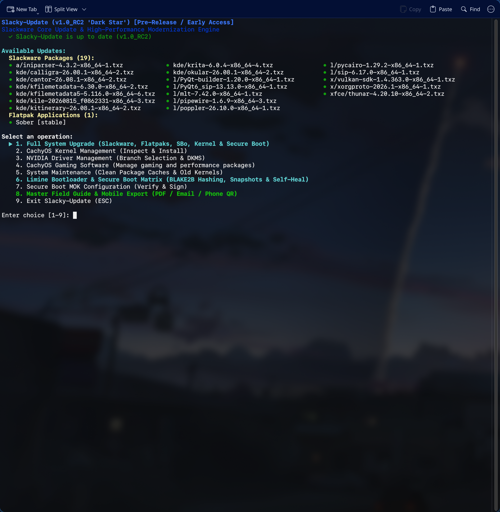
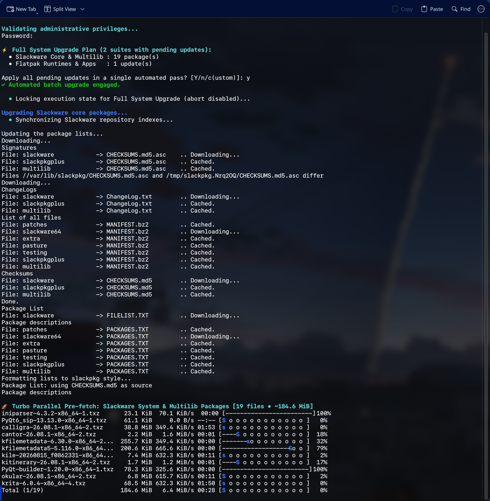
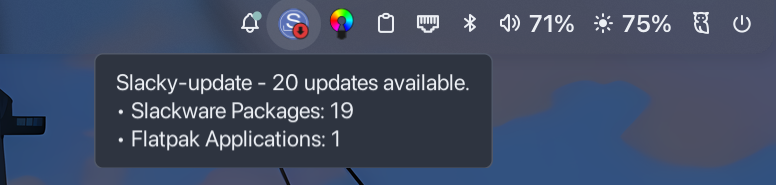
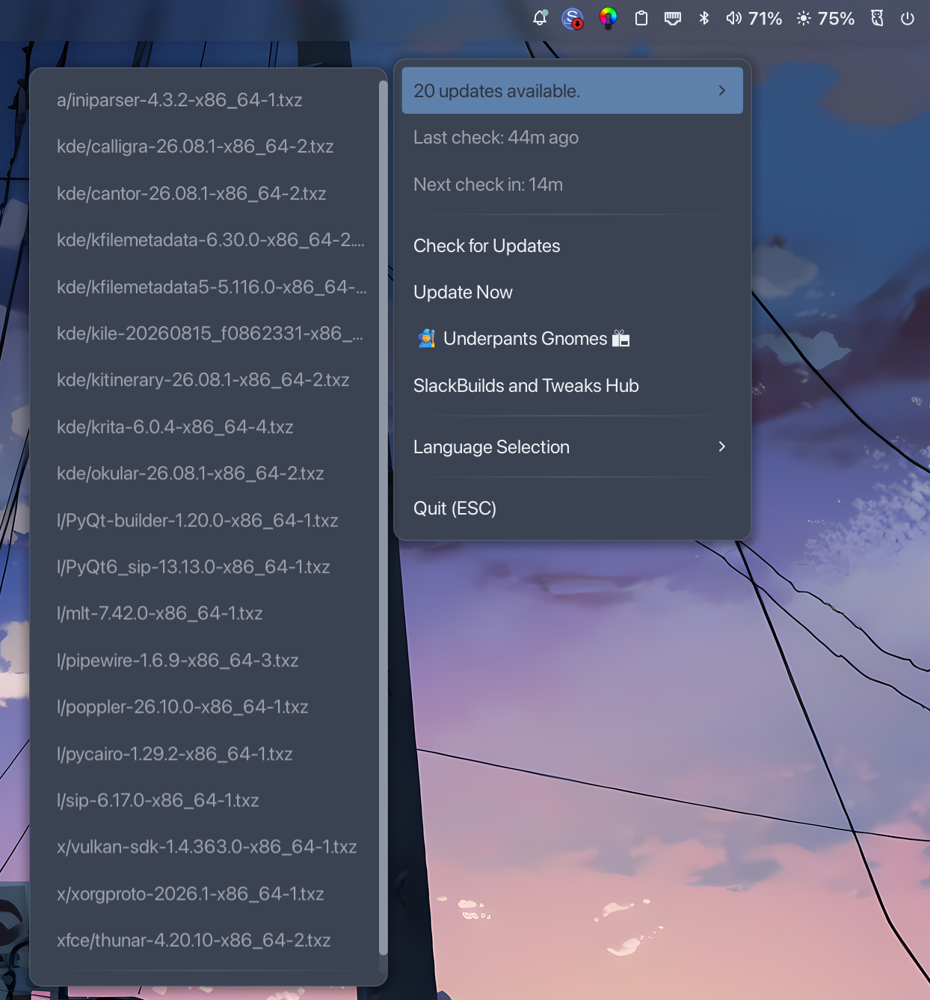
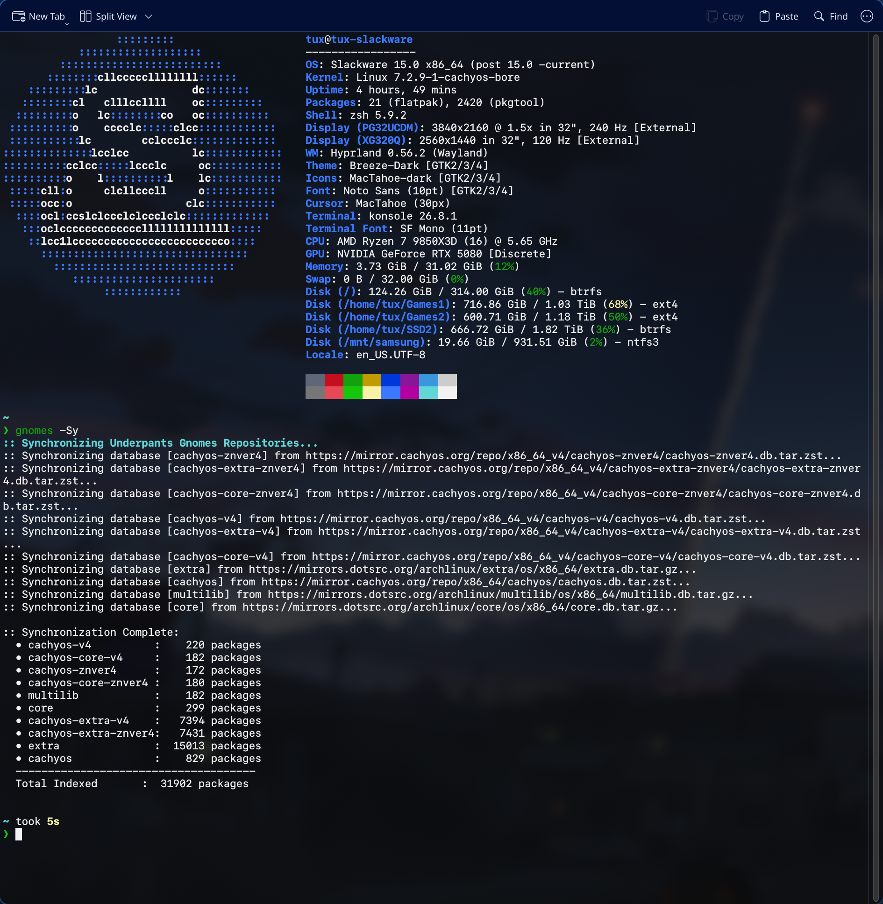
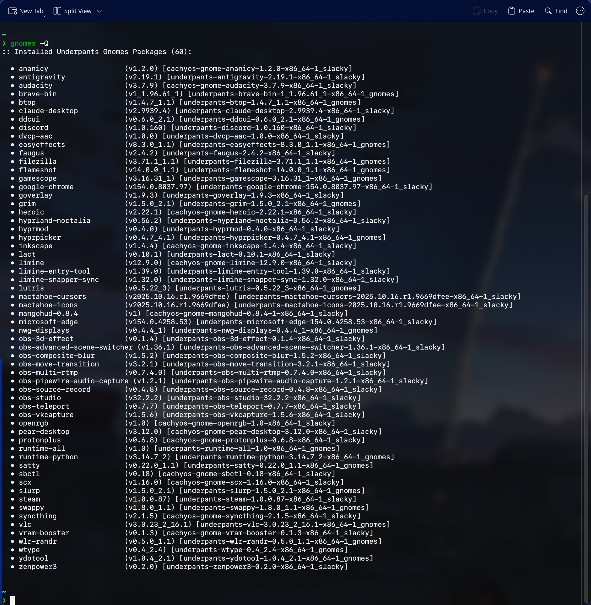
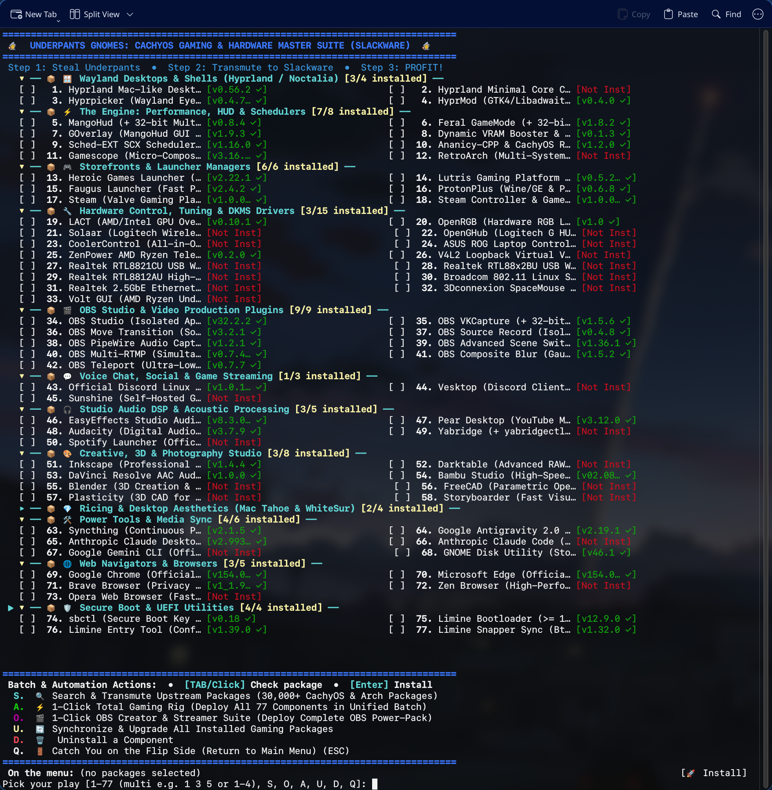

<div align="center">

# ⚡ Slacky-Update
### *High-Performance System Upgrade, CachyOS Kernel Lifecycle, Driver Orchestrator & Workstation Modernization Suite for Slackware Linux*
#### `v1.0 LTS` — *"Dark Star"* (Official Long-Term Support Release)

[](http://www.slackware.com/)
[](https://github.com/TuxOfValhalla/slacky-update/releases)
[](LICENSE)
[](lib/)
[-yellow?style=for-the-badge)](locales/)
[](docs/THE_ULTIMATE_SLACKY_UPDATE_SURVIVAL_GUIDE.md)

---

**Slacky-Update** is an all-in-one system upgrade station, CachyOS kernel manager, graphics driver orchestrator, and high-performance gaming suite engineered specifically for **Slackware Linux (-current / 15.0+)**.

*Pure Slackware philosophy • Zero external runtime dependencies • Native `.txz` packaging • Safe, reversible operations*

</div>

---

## 🖥️ The Interactive Command Center

Slacky-Update features a state-of-the-art interactive TUI engine built entirely on the Python 3 standard library. It dynamically adapts to your terminal dimensions, automatically budgets vertical space, and provides full native mouse text selection for effortless clipboard sharing with LLMs.

| 📋 Dynamic Package Status & ChangeLog Grid | 🎮 Intuitive Operations & Navigation |
| :---: | :---: |
|  |  |
| *Real-time 2/3-column package layout with automatic terminal height budgeting* | *Arrow-key navigation, instant number jumping, and universal `(ESC)` back navigation* |

---

## 🛡️ Peace of Mind by Design: Simplicity, Not Complexity

Slackware is revered for its simplicity, stability, and lack of abstraction. But running a bleeding-edge modern workstation—with PCIe Gen 4/5 NVMe SSDs, modern NVIDIA Ada/Blackwell GPUs, low-latency PipeWire pro-audio, and high-refresh gaming—often forces users to manually coordinate a fragile web of kernels, initrd builds, DKMS modules, and sysctl configs.

**Slacky-Update does not replace Slackware; it liberates you from manual friction.**

* **You Are Always in Control:** Slacky-Update never executes intrusive system operations behind your back. Every major operation presents a clear, human-readable summary before asking for your explicit confirmation.
* **In-Flight Transaction Armor:** Accidental keystrokes cannot corrupt your system. Once a package upgrade or kernel deployment begins, signals (`INT`, `QUIT`, `TSTP`) are safely trapped until the transaction completes cleanly.
* **Zero Coexistence Conflict:** Existing bootloaders (GRUB, ELILO) and system tools remain untouched and functional as fallbacks.
* **Granular Reversibility:** Every system tweak, boot parameter, and kernel option can be toggled on or reverted individually with a single keypress.
* **Btrfs Snapshot Safeguard:** Integrated Snapper snapshot rollbacks ensure you can always restore your exact previous state in seconds.

---

## 🔔 Seamless Desktop Integration

Whether you work in **KDE Plasma Wayland**, **XFCE**, or **Hyprland**, the Slacky-Update companion tray applet runs quietly in the background, monitoring Slackware ChangeLogs and upstream package repositories without waking your CPU unnecessarily.

| 🎛️ Unobtrusive Status Applet | ⚡ 1-Click Operations Launcher |
| :---: | :---: |
|  |  |
| *Lightweight tray notification badge when updates are ready* | *Right-click access to kernel management, full upgrades, and system tools* |

---

## ⚡ First-Principles Engineering & Performance

Slacky-Update incorporates cutting-edge optimizations engineered to eliminate micro-stutters, minimize system latency, and unlock the full potential of high-end hardware:

* **🚀 CachyOS High-Performance Kernels:** Deploy and manage 11 specialized CachyOS kernel flavors (BORE, LTS, RC, BMQ, EEVDF) built for high-throughput responsiveness and gaming frame pacing.
* **⚡ Multi-Core FastBoot Compression:** Generates dracut initramfs images using parallel zstd level 1 (`compress="zstd -1 -T0"`), dropping kernel boot decompression overhead to sub-20 milliseconds.
* **🏎️ NVMe Direct I/O Bypass:** Automatically applies hardware bypass (`none` I/O scheduler) to PCIe Gen 4/5 NVMe SSDs, eliminating kernel queue lock contention during intense gaming and compiling workloads.
* **🎮 10GB Global Shader Disk Cache:** Permanent shader retention for NVIDIA and Mesa (`__GL_SHADER_DISK_CACHE_SIZE=10737418240`), eradicating shader re-compilation stutters across titles like Cyberpunk 2077 and Unreal Engine 5.
* **🎵 Low-Latency Pro-Audio:** Drop-in PipeWire quantum configuration locked to 256 samples (5.3ms) paired with RT95 audio limits for zero-xrun audio production and gaming communication.
* **🛡️ Limine BLAKE2B Security Matrix:** UEFI bootloader with cryptographic BLAKE2B kernel and initramfs digest verification. Features a guided, streamlined setup for Secure Boot MOK key generation and enrollment—which operates fully automatically on all subsequent kernel builds once configured.

---

## 📦 Transmuted Software Ecosystem (Underpants Gnomes)

Need bleeding-edge applications not yet packaged in standard Slackware or SlackBuilds repositories? Slacky-Update’s **Underpants Gnomes engine** delivers pure package transmutation with zero compromise to your host system:

* **In-Memory Streaming Transmutation:** Inspects and decompresses upstream Arch/CachyOS package archives (`.pkg.tar.zst`) directly in RAM using the Python 3 standard library and the stock `zstd` command-line tool. Zero foreign package managers (`pacman`, `libalpm`, `apt`, `dnf`) are ever installed or executed on your host system.
* **Isolated `/opt/underpants/` Architecture:** Applications, shared runtime libraries, and assets are extracted and maintained strictly inside isolated `/opt/underpants/` directory structures with private `RPATH`/`RUNPATH` environments.
* **Host Sovereignty Shielding:** Native Slackware system libraries (`/lib64`, `/usr/lib64`, system `glibc`, PAM, and SysVinit) are 100% shielded and protected from upstream ABI clashes or runtime overrides.
* **Zero Host Package Pollution:** Transmuted software builds authentic namespaced Slackware `.txz` packages (`underpants-*.txz`) and installs cleanly via Slackware's native `upgradepkg --install-new`. They log cleanly under `/var/log/packages/underpants-*`, ensuring native Slackware packages (`AAA_base`, `glibc`, `coreutils`, etc.) are never overwritten, hijacked, or corrupted. Slackware’s host sovereignty remains 100% shielded and pristine.
* **Seamless Desktop & CLI Access:** Provides lightweight launch wrappers in `/usr/bin` and desktop entries in `/usr/share/applications` so transmuted applications integrate seamlessly into KDE Plasma, XFCE, and Hyprland just like native software.

| 🚀 Sidecar Quick-Launch Station | 🗂️ Intuitive Category Explorer |
| :---: | :---: |
|  |  |

```
┌─────────────────────────────────────────────────────────────────────────────┐
│                   UNDER PANTS GNOMES SOFTWARE SUITE (TUI)                   │
└─────────────────────────────────────────────────────────────────────────────┘
```
<div align="center">

  
*Full interactive software grid with category expansion, live status badges, and batch deployment*

</div>

---

## 🚀 Quickstart: Installation & Build

Slacky-Update adheres strictly to Slackware's native packaging standards. Build and install the verified `.txz` package using one of the automated one-liners below, or follow the step-by-step instructions:

### ⚡ 1-Line Automated Install

**From GitHub:**
```bash
git clone https://github.com/TuxOfValhalla/slacky-update.git && cd slacky-update && bash slackbuild/slacky-update.SlackBuild && sudo upgradepkg --reinstall --install-new "$(ls -t ../slacky-updates_releases/slacky-update-[0-9]*.txz | head -n 1)" && slacky-update
```

**From Codeberg:**
```bash
git clone https://codeberg.org/TuxOfValhalla/slacky-update.git && cd slacky-update && bash slackbuild/slacky-update.SlackBuild && sudo upgradepkg --reinstall --install-new "$(ls -t ../slacky-updates_releases/slacky-update-[0-9]*.txz | head -n 1)" && slacky-update
```

### 🛠️ Step-by-Step Manual Build
```bash
# 1. Clone the repository
git clone https://github.com/TuxOfValhalla/slacky-update.git
cd slacky-update

# 2. Build the native Slackware package
bash slackbuild/slacky-update.SlackBuild

# 3. Install or upgrade the package (the build writes it next to the repository, never to /tmp)
sudo upgradepkg --reinstall --install-new "$(ls -t ../slacky-updates_releases/slacky-update-[0-9]*.txz | head -n 1)"

# 4. Launch Slacky-Update
slacky-update
```

### 🖱️ Mouse Navigation & Terminal Text Copying (Pro-Tip)
* **Direct Mouse Navigation:** Click any menu option (1–9, checkboxes, buttons) to select or execute operations directly with your mouse.
* **Text Selection & Copying (LLM Workflows):** Terminal emulators with mouse tracking enabled capture click events by default. To highlight and copy package lists or terminal text directly to your clipboard, **hold `Shift` while dragging your mouse** (`Shift + Drag`). This temporarily bypasses application mouse tracking in Konsole, Alacritty, Foot, and Kitty, copying pristine plain text instantly.

---

## 🌍 Multilingual Support (24 Languages)

English (`en`) and Norwegian Bokmål (`nb`) are complete. The other 22 language packs are partial: texts that are not translated yet are shown in English. The language is chosen automatically from your system's `$LANG` and `$LC_MESSAGES`:

| Language | Code | Language | Code | Language | Code |
| :--- | :--- | :--- | :--- | :--- | :--- |
| 🇬🇧 **English (Default)** | `en` | 🇳🇴 **Norwegian (Bokmål)** | `nb` | 🇳🇴 **Norwegian (Nynorsk)** | `nn` |
| 🇩🇪 **Deutsch** | `de` | 🇫🇷 **Français** | `fr` | 🇪🇸 **Español** | `es` |
| 🇮🇹 **Italiano** | `it` | 🇵🇹 **Português** | `pt` | 🇳🇱 **Nederlands** | `nl` |
| 🇩🇰 **Dansk** | `da` | 🇸🇪 **Svenska** | `sv` | 🇫🇮 **Suomi** | `fi` |
| 🇮🇸 **Íslenska** | `is` | 🇵🇱 **Polski** | `pl` | 🇷🇺 **Русский** | `ru` |
| 🇨🇳 **简体中文** | `zh` | 🇯🇵 **日本語** | `ja` | 🇰🇷 **한국어** | `ko` |
| 🇮🇳 **हिन्दी** | `hi` | 🇸🇦 **العربية** | `ar` | 🇨🇦 **English (Canada)**| `en-ca` |
| ❄️ **Davvisámegiella** | `se` | 🛹 **Radical English** | `en-radical` | ⚡ **Radical Norwegian** | `nb-radical` |

---

## 📖 Documentation & Field Guides

Comprehensive technical documentation is maintained in the `docs/` directory:

* [The Ultimate Slacky-Update Survival Guide](docs/THE_ULTIMATE_SLACKY_UPDATE_SURVIVAL_GUIDE.md) — *Complete operator manual and quick-reference.*
* [Limine & Secure Boot Field Guide](docs/LIMINE_SECUREBOOT_FIELD_GUIDE.md) — *UEFI cryptographic matrix, MOK keys, and snapshot recovery.*
* [Technical Companion Guide](docs/TECHNICAL_COMPANION_GUIDE.md) — *Underlying architecture, signal safety, and module breakdown.*
* [Oh My Hyprland Guide](docs/OH_MY_HYPRLAND_GUIDE.md) — *Wayland desktop setup and integration guide.*

---

## ⚖️ System Requirements, Liability & Legal Disclaimers

### 💻 Target System Requirements
* **Target Operating System:** Slackware Linux `-current` (or Slackware 15+).
* **Hardware Architecture:** `x86_64` (optimized for modern CPUs with AVX2 / AVX-512 support).

### 🛡️ Use at Your Own Risk
Slacky-Update executes low-level modifications to foundational system components, including kernel deployments, graphics driver stacks, initramfs images, and UEFI bootloader topologies. While engineered with strict safety guardrails, signal traps, and rollback capabilities, **all installations, kernel updates, and system modifications are performed strictly at your own discretion and risk**. The authors, maintainers, and contributors assume **no liability or warranty** for data loss, hardware quirks, or unbootable system states. Always ensure your personal data is backed up before performing major system upgrades.

### 🤖 AI Pair Programming Disclosure
Slacky-Update has been engineered utilizing advanced **AI pair programming and agentic coding workflows**, developed in continuous close collaboration with a human Linux systems architect. Every module, refactoring pass, and test suite has been iteratively planned, audited, and verified against high standards of system performance, safety, and comfort.

### ⚖️ Trademark & Non-Affiliation Disclaimer
Slacky-Update is an independent community open-source project. It is **not** an official product of Slackware Linux, Inc., nor is it endorsed, sponsored, affiliated with, or maintained by Patrick Volkerding or the official Slackware project. 
The name "Slackware" and the Slackware logo are used solely under **nominative fair use** for identification and compatibility purposes, to identify that this utility is designed and engineered specifically for the Slackware Linux operating system.
