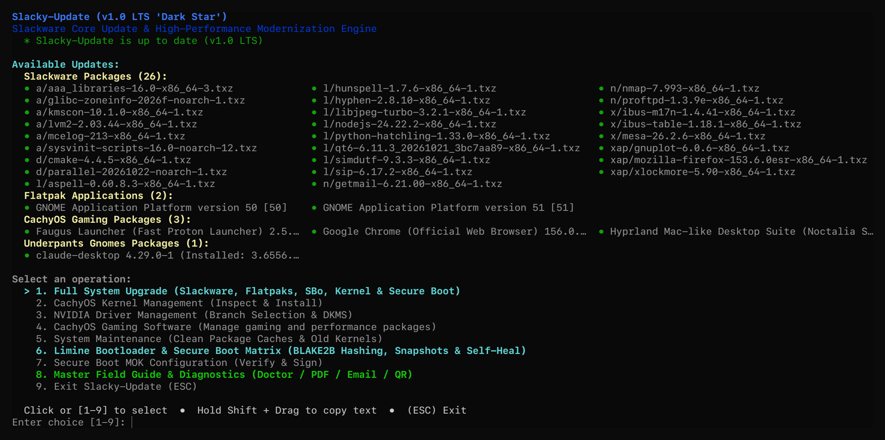
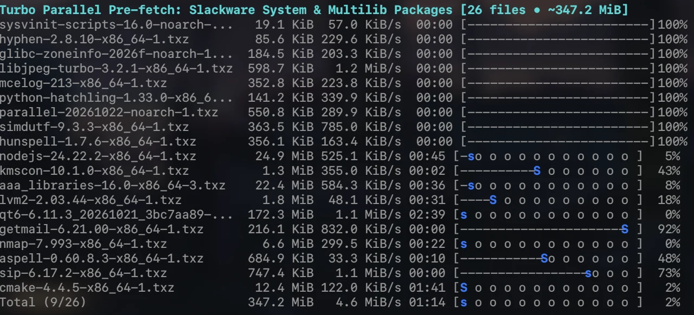
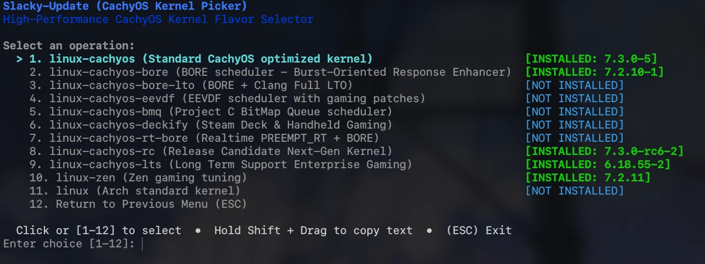
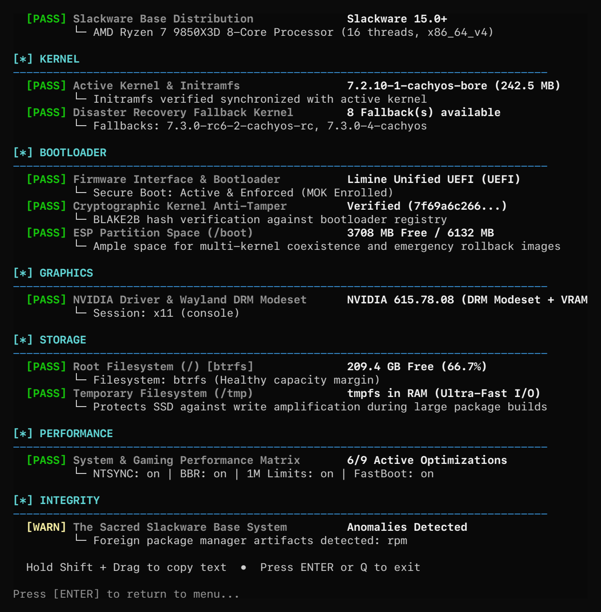
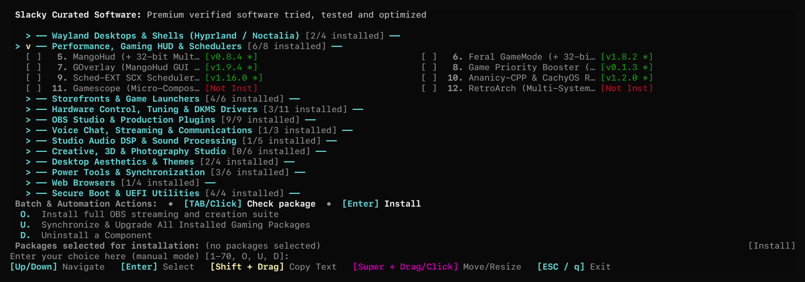

<div align="center">

# ⚡ Slacky-Update
### *System upgrades, CachyOS kernels, NVIDIA drivers, Limine & Secure Boot and curated gaming software for Slackware Linux*
#### `v1.0 LTS` — *"Dark Star"* (Long-Term Support Release)

[](http://www.slackware.com/)
[](https://github.com/TuxOfValhalla/slacky-update/releases)
[](LICENSE)
[](locales/)
[](docs/THE_ULTIMATE_SLACKY_UPDATE_SURVIVAL_GUIDE.md)

*Native Slackware `.txz` packaging • Shows you the plan and asks before it changes anything*

</div>

---

## 👋 What is Slacky-Update?

**Slacky-Update keeps a Slackware computer up to date from one menu.** Start it, read the list of what is new, pick a number, and it does the rest: Slackware packages, Flatpaks, SlackBuilds (SBo), the kernel, the NVIDIA driver, the boot menu and Secure Boot signatures, in the right order.

It does not replace Slackware or its tools. It runs them for you, with safety checks around every step.

*New to this? You use it in a terminal (the window where you type commands): install it once with the lines under **Installation**, then type `slacky-update` and press `Enter`.*


*The main menu: every pending update grouped by source, and nine operations to choose from with the arrow keys, a number or the mouse.*

---

## 🧭 The Main Menu

| # | Operation | What it does |
| :-: | :--- | :--- |
| 1 | **Full System Upgrade** | Slackware, Flatpaks, SBo, kernel and Secure Boot in one run |
| 2 | **CachyOS Kernel Management** | Upgrade installed CachyOS kernels, pick a new flavor (BORE, EEVDF, BMQ, RT, LTS, RC, Zen …), prune old kernels, rebuild the initramfs |
| 3 | **NVIDIA Driver Management** | Full CachyOS NVIDIA suite (64-bit + 32-bit multilib, all kernels), DKMS rebuild and signing, legacy `.run` branches (595, 570, 535, 470, 390) |
| 4 | **CachyOS Gaming Software** | The curated software catalog (see below) |
| 5 | **System Maintenance** | Shows how much space can be freed, then cleans caches, old kernels and unused Flatpak runtimes. `/home` is left alone |
| 6 | **Limine Bootloader & Secure Boot Matrix** | Limine install (next to GRUB/ELILO), BLAKE2B hash enrollment and checks, kernel command line, Snapper rollback, self-heal from backup |
| 7 | **Secure Boot MOK Configuration** | Secure Boot audit, the sbctl key-enrollment wizard, signing of bootloaders and kernels, classic MOK for kernel modules |
| 8 | **Master Field Guide & Diagnostics** | System health audit, health report, the guides in the terminal, PDF export, email and Wi-Fi QR transfer to a phone |
| 9 | **Exit** | `ESC` works as "back" in every menu |

*On AMD systems line 3 is **AMD ROCm** instead. On machines with neither, the menu has eight lines and the numbers after 2 move up by one.*


*Menu 1 → Full System Upgrade: after one yes, all packages are downloaded in parallel, then installed in a safe order.*


*Menu 2 → Kernel Picker: eleven kernel flavors side by side, with what is already installed.*

Everything can also be started directly from the command line. Run `slacky-update --help` for the full list, for example `slacky-update --check` (read-only status), `--doctor` (health audit) or `-y` (unattended full upgrade).

---

## 🩺 Health Audit

`slacky-update --doctor` (or menu 8 → 1) checks the system without changing anything: kernel and initramfs, fallback kernels, Limine and Secure Boot, BLAKE2B anti-tamper hashes, free space on `/boot`, the NVIDIA driver, storage, performance settings and the integrity of the Slackware base system.

<div align="center">



</div>

---

## 📦 Curated Software (Underpants Gnomes)

Menu 4 opens **Slacky Curated Software**: tested apps in twelve categories, such as Hyprland desktops, gaming HUDs and schedulers, game launchers, hardware tuning, OBS Studio with plugins, voice chat, studio audio, creative tools, themes, power tools, web browsers and Secure Boot utilities. Tick what you want with `TAB` or the mouse and press `Enter`.



Apps that Slackware does not ship are built by the **Underpants Gnomes** engine. It takes Arch Linux / CachyOS packages and turns them into real Slackware `.txz` packages:

* **No foreign package manager.** `pacman` is never installed or run. The packages are unpacked with Python and the stock `zstd` tool.
* **Kept apart from the system.** Apps and their private libraries live under `/opt/underpants/` and are installed with Slackware's own `upgradepkg`, named `underpants-*`. Slackware's own packages (`glibc`, `aaa_base`, …) are never overwritten.
* **Normal desktop apps.** Launchers in `/usr/bin` and menu entries in `/usr/share/applications`.
* **Also a command:** `gnomes search <name>`, `gnomes info <pkg>`, `gnomes deps <pkg>`, `gnomes install <pkg>`, `gnomes -Syu`, `gnomes --rollback <pkg>` (see `gnomes --help`).

---

## 🛡️ Safety by Design

* **You stay in control.** Bigger operations show a plain summary first and wait for your yes.
* **Protected updates.** While a package or kernel update runs, `Ctrl+C`, closing the terminal and similar signals are held back until the step is finished. A power cut can still interrupt a step.
* **Boot chain guard.** Kernels, initramfs images and `limine.conf` are checked with BLAKE2B hashes and Secure Boot signatures. A last known good Limine setup is kept for self-heal.
* **Btrfs snapshots.** With Snapper you can roll back to an earlier state from the boot menu.
* **Existing bootloaders stay.** GRUB and ELILO are left alone and keep working as a fallback.
* **SpiderSense.** A quiet, read-only watcher (`spidersense status`) notices damaged packages, mirror trouble and hardware changes. Repairs are left to Slacky-Update.
* **Tray applet.** `slacky-update-tray` shows when updates are waiting (KDE Plasma, XFCE, Hyprland).

---

## 🚀 Installation

> ⚠️ Slacky-Update changes kernels, drivers and boot files. Read **Use at your own risk** at the bottom of this page first.

You need `git`, internet access and `sudo`. Slacky-Update is built as a native Slackware package; the build writes it to `../slacky-updates_releases/`, next to the repository.

**Step by step:**
```bash
# 1. Get the source
git clone https://github.com/TuxOfValhalla/slacky-update.git
cd slacky-update

# 2. Build the Slackware package
bash slackbuild/slacky-update.SlackBuild

# 3. Install or upgrade it
sudo upgradepkg --reinstall --install-new "$(ls -t ../slacky-updates_releases/slacky-update-[0-9]*.txz | head -n 1)"

# 4. Start it
slacky-update
```

**Shortcut (build, install and start in one line):**

*From GitHub:*
```bash
git clone https://github.com/TuxOfValhalla/slacky-update.git && cd slacky-update && bash slackbuild/slacky-update.SlackBuild && sudo upgradepkg --reinstall --install-new "$(ls -t ../slacky-updates_releases/slacky-update-[0-9]*.txz | head -n 1)" && slacky-update
```

*From Codeberg:*
```bash
git clone https://codeberg.org/TuxOfValhalla/slacky-update.git && cd slacky-update && bash slackbuild/slacky-update.SlackBuild && sudo upgradepkg --reinstall --install-new "$(ls -t ../slacky-updates_releases/slacky-update-[0-9]*.txz | head -n 1)" && slacky-update
```

**Tips:**
* Click a menu line to choose it, or use the arrow keys and `Enter`, or type its number.
* To copy text from the screen (for example to paste into a forum post), **hold `Shift` while you drag** with the mouse.

---

## 🌍 Languages

Slacky-Update speaks 24 languages and picks one from `$LANG` / `$LC_MESSAGES`. Change it with `slacky-update --lang <code>` and see the list with `slacky-update --list-langs`.

| Language | Code | Language | Code | Language | Code |
| :--- | :--- | :--- | :--- | :--- | :--- |
| 🇬🇧 **English (default)** | `en` | 🇳🇴 **Norsk (bokmål)** | `nb` | 🇳🇴 **Norsk (nynorsk)** | `nn` |
| 🇩🇪 **Deutsch** | `de` | 🇫🇷 **Français** | `fr` | 🇪🇸 **Español** | `es` |
| 🇮🇹 **Italiano** | `it` | 🇵🇹 **Português** | `pt` | 🇳🇱 **Nederlands** | `nl` |
| 🇩🇰 **Dansk** | `da` | 🇸🇪 **Svenska** | `sv` | 🇫🇮 **Suomi** | `fi` |
| 🇮🇸 **Íslenska** | `is` | 🇵🇱 **Polski** | `pl` | 🇷🇺 **Русский** | `ru` |
| 🇨🇳 **简体中文** | `zh` | 🇯🇵 **日本語** | `ja` | 🇰🇷 **한국어** | `ko` |
| 🇮🇳 **हिन्दी** | `hi` | 🇸🇦 **العربية** | `ar` | 🇨🇦 **English (Canada)** | `en-ca` |
| ❄️ **Davvisámegiella** | `se` | 🛹 **Radical English** | `en-radical` | ⚡ **Radical Norwegian** | `nb-radical` |

English and Norwegian Bokmål are maintained by the author. The other languages are machine-assisted translations; corrections from native speakers are welcome.

---

## 📖 Documentation

The guides are installed to `/usr/share/slacky-update/docs/`. You can read them from menu 8 or export them to PDF there.

* [The Ultimate Slacky-Update Survival Guide](docs/THE_ULTIMATE_SLACKY_UPDATE_SURVIVAL_GUIDE.md): the operator manual and quick reference.
* [Slacky-Update Field Guide](docs/SLACKY_UPDATE_FIELD_GUIDE.md): everyday use, menu by menu.
* [Limine & Secure Boot Field Guide](docs/LIMINE_SECUREBOOT_FIELD_GUIDE.md): Limine, BLAKE2B, MOK/sbctl keys and snapshot recovery.
* [Underpants Gnomes Field Guide](docs/UNDERPANTS_GNOMES_FIELD_GUIDE.md): the curated software and the `gnomes` command.
* [Troubleshooting Guide](docs/TROUBLESHOOTING_GUIDE.md): what to do when something goes wrong.
* [Technical Companion Guide](docs/TECHNICAL_COMPANION_GUIDE.md): architecture, modules and safety mechanisms.
* [Oh My Hyprland Guide](docs/OH_MY_HYPRLAND_GUIDE.md): the Hyprland desktop suite.

---

## ⚖️ Requirements, Liability & Legal

### 💻 Requirements
* **Operating system:** Slackware Linux `-current` (or Slackware 15.0+).
* **Architecture:** `x86_64`.

### 🛡️ Use at your own risk
Slacky-Update changes core parts of the system: kernels, graphics drivers, initramfs images and the UEFI boot setup. It is built with safety checks, signal guards and rollback paths, but **all installations and system changes are made at your own risk**. The authors and contributors give **no warranty** and accept **no liability** for data loss, hardware problems or a system that does not start. Back up your personal data before major upgrades.

### 🤖 AI pair programming
Slacky-Update was developed with AI pair programming and agentic coding tools, in close collaboration with a human Linux systems architect who planned, reviewed and tested every change.

### ⚖️ Trademarks and non-affiliation
Slacky-Update is an independent community open-source project. It is **not** an official Slackware product and is not endorsed, sponsored, affiliated with or maintained by Patrick Volkerding or the Slackware project. The name "Slackware" is used only under **nominative fair use**, to say which operating system this tool is made for.
