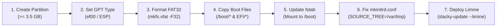

# ⚡ Limine Bootloader & Secure Boot Field Guide
### *Slackware Linux 15+ — Unified Boot, Cryptographic Sealing & Secure Boot Playbook*
#### `v1.0 LTS` — *"Dark Star"* (Official Long-Term Support Release)

---

> [!IMPORTANT]
> **TARGET DISTRIBUTION REQUIREMENT & VERSION MANDATE**  
> **Slacky-Update is engineered strictly for Slackware 15+ (`slackware-current` / `Slackware 16 alpha`).**  
> Legacy **Slackware 15.0 (stable)** is strictly unsupported due to older core libraries, toolchains, and sonames that cause conflicts that cannot be detected or resolved. Slackware 15.0 users must upgrade to `-current` before using this suite.

> [!CAUTION]
> ### ⚠️ IMPORTANT DISCLAIMER & LIABILITY NOTICE
> **READ CAREFULLY BEFORE PROCEEDING WITH ANY BOOTLOADER OR DISK CHANGES.**
> 
> Modifying disk partitions, filesystems, mount points, UEFI NVRAM entries, and bootloaders carries inherent risk of data loss and unbootable systems.
> 
> * **100% At Your Own Risk:** Any action you perform—whether manually following this guide or using the automated tools in `slacky-update`—is executed strictly at your own discretion and risk.
> * **No Warranty or Liability:** The authors, maintainers, and contributors of Slacky-Update provide this software and documentation "AS IS", without warranty of any kind, express or implied. In no event shall the authors be liable for any claim, damages, data loss, downtime, corrupted filesystems, bricked firmware, or system failure arising from the use of these instructions or scripts.
> * **Mandatory Backup:** Always verify that you have complete, tested, and current backups of all essential data, as well as access to a bootable Slackware live USB rescue media, before modifying partitions or bootloaders.

---

## 📑 Table of Contents
1. [Core Philosophy: The Sacred Slackware Base & The Five Pillars](#1-core-philosophy-the-sacred-slackware-base--the-five-pillars)
2. [🧩 ELI5: How Modern UEFI Booting & Limine Work](#2-eli5-how-modern-uefi-booting--limine-work)
3. [🛠️ The Gold Standard: Manual Pre-Configuration Guide (A to Z)](#3-the-gold-standard-manual-pre-configuration-guide-a-to-z)
4. [🤖 What Slacky-Update Does Under Automatic Configuration](#4-what-slacky-update-does-under-automatic-configuration)
   - [Scenario B: Existing Best Practice (Current System)](#scenario-b-existing-best-practice-current-system)
   - [Scenario A: In-Place ESP Promotion (/boot/efi -> /boot)](#scenario-a-in-place-esp-promotion-bootefi---boot)
   - [Scenario C: New Dedicated ESP Partition Adoption](#scenario-c-new-dedicated-esp-partition-adoption)
5. [🎨 Customization, CMDLINE & Gaming Optimization Hub](#5-customization-cmdline--gaming-optimization-hub)
   - [Two-Zone Architecture](#the-two-zone-limineconf-architecture)
   - [Split-Lock Mitigation Toggle (split_lock_mitigate=0)](#split-lock-mitigation-toggle-split_lock_mitigate0)
6. [🔒 Safe Hashing & Anti-Lockout Model](#6-safe-hashing--anti-lockout-model)
7. [🛡️ Secure Boot Setup with sbctl (Guided Manual Setup, Automatic Future)](#7-secure-boot-setup-with-sbctl-guided-manual-setup-automatic-future)
8. [🖥️ Motherboard UEFI/BIOS Configuration Matrix](#8-motherboard-uefibios-configuration-matrix)
   - [🔴 ASUS (ROG, TUF Gaming, Prime)](#-asus-rog-tuf-gaming-prime)
   - [🔵 ASRock](#-asrock)
   - [🐉 MSI (Click BIOS 5 / Click BIOS X)](#-msi-click-bios-5--click-bios-x)
   - [🟠 Gigabyte / AORUS](#-gigabyte--aorus)
9. [🌲 Btrfs Snapper Snapshot Rollbacks & Auto-Sync Engine](#9-btrfs-snapper-snapshot-rollbacks--auto-sync-engine)
10. [🚑 Emergency Recovery & Zero-Destruction Coexistence](#10-emergency-recovery--zero-destruction-coexistence)

---

## 1. Core Philosophy: The Sacred Slackware Base & The Five Pillars

Slacky-Update’s bootloader management is built directly upon **The Sacred Slackware Base System** and **The Five Engineering Pillars**:
* **The Sacred Slackware Base System:** Stock Slackware kernels (`vmlinuz-generic`, `vmlinuz-huge`), stock initrds, and default bootloaders (GRUB, ELILO) are **never wiped, modified, or overwritten**. Limine coexists side-by-side with GRUB in UEFI NVRAM, guaranteeing you can always boot your original system.
* **⚡ Speed:** Limine loads kernels in under 20 milliseconds directly from FAT32, eliminating GRUB's massive filesystem parsing overhead.
* **🛋️ Comfort:** Automated ChangeLog tracking, dual-zone configuration that protects your custom themes, and instant snapshot rollbacks.
* **🛡️ Safety:** Cryptographic BLAKE2B hashes seal every kernel and initramfs binary. Guided manual Secure Boot setup ensures your motherboard keys are enrolled safely, and active kernel armor protects your current system.
* **🎨 UI Design:** Clean retro Dark Star theme, native 4K UHD rendering, WinAmp style translucent background box, and zero visual artifacts.
* **🤝 Ease of Use:** 1-Click self-heal, guided manual MOK setup that handles all future kernel signing 100% automatically, and universal `(ESC)` navigation across all menus.

---

## 2. 🧩 ELI5: How Modern UEFI Booting & Limine Work

### What is a Bootloader, really?
Think of your computer when it turns on like a librarian in a huge library:
1. **The Motherboard (UEFI Firmware):** This is the librarian. It only knows how to read one specific language: **FAT32**.
2. **GRUB (The Heavyweight):** GRUB is like bringing an entire translator team with 50 dictionaries into the library. GRUB is massive (15+ MB) and has its own custom mini-operating system just to read Linux filesystems (ext4, Btrfs). It is slow, complex, and prone to breaking during filesystem updates.
3. **Limine (The Modern Sports Car):** Limine is lightweight, pure, and ultra-fast. Instead of bringing heavy translators, Limine speaks the motherboard's native language (FAT32) directly.

### Why do we need $\ge 3.5\text{ GB}$ FAT32 on `/boot`?
Back in 2012, standard Linux installations created a tiny 100 MB or 512 MB EFI System Partition (ESP) at `/boot/efi`. That worked when you only had one single 5 MB kernel.

Today, a modern gaming and power-user Slackware system has:
* **Slackware Stock Kernel + Initrd:** ~60 MB
* **CachyOS High-Performance Kernel + Dracut Initramfs:** ~120 MB
* **NVIDIA Kernel Modules:** ~50 MB
* **Btrfs Snapper Boot Snapshots (7-Day Rollback Spread):** ~500 MB – 1.5 GB
* **CPU Early Microcode & UEFI Splash Graphics:** ~30 MB

If your boot partition is only 512 MB, your system will rapidly run out of disk space during kernel updates, resulting in broken initramfs builds and boot failure.

By mounting a dedicated **$\ge 3.5\text{ GB}$ (recommended 4 GB) FAT32 partition directly at `/boot`**, everything is stored in one place. Limine can read kernels, initramfs, and Btrfs snapshots with **zero copying, zero filesystem translation overhead, and instant cryptographic BLAKE2B verification**!

---

## 3. 🛠️ The Gold Standard: Manual Pre-Configuration Guide (A to Z)

> [!TIP]
> **Best Practice Recommendation:**
> While `slacky-update` includes an automated migration wizard, **doing the disk preparation manually is considered best practice**. Manual setup ensures you have complete visual oversight of your drive partitioning and know exactly where your files reside.

Follow this complete step-by-step checklist to prepare your system for Limine:



---

### Step 1: Create or Resize a Partition ($\ge 3.5\text{ GB}$)
Using **GParted** (GUI) or **cfdisk** (terminal):
1. Shrink an existing partition on your NVMe or SSD to free up at least **4096 MB (4 GB)**.
2. Create a new partition in the unallocated space (e.g., `/dev/nvme0n1p4` or `/dev/sda3`).

---

### Step 2: Set the GPT Partition Type to `ef00` (EFI System Partition)
The UEFI motherboard firmware and `sbctl` require the partition to be flagged as an official **EFI System Partition** (GUID `c12a7328-f81f-11d2-ba4b-00a0c93ec93b`).

Run using `sgdisk` or `parted`:
```bash
# Using sgdisk (Replace /dev/nvme0n1 and partition number 4 with your drive):
sudo sgdisk -t 4:ef00 /dev/nvme0n1
```

---

### Step 3: Format the Partition with FAT32
Format with standard 32-bit FAT and set the label to `ESP` or `LIMINE_BOOT`:
```bash
sudo mkfs.vfat -F32 -n "LIMINE_BOOT" /dev/nvme0n1p4
```

---

### Step 4: Stash and Copy Existing Boot Files
1. Create a temporary mount point:
   ```bash
   sudo mkdir -p /mnt/new_boot
   sudo mount /dev/nvme0n1p4 /mnt/new_boot
   ```
2. Copy all current kernel binaries, System.maps, and initramfs files from `/boot/*`:
   ```bash
   sudo cp -a /boot/* /mnt/new_boot/
   ```
3. If `/boot/efi` exists, copy the EFI directory structure:
   ```bash
   sudo mkdir -p /mnt/new_boot/EFI
   sudo cp -a /boot/efi/EFI/* /mnt/new_boot/EFI/
   ```
4. Unmount the temporary mount:
   ```bash
   sudo umount /mnt/new_boot
   sudo rmdir /mnt/new_boot
   ```

---

### Step 5: Update `/etc/fstab`
Obtain the UUID of your new partition:
```bash
sudo blkid -s UUID -o value /dev/nvme0n1p4
```
Edit `/etc/fstab` (`sudo nano /etc/fstab`):
1. Comment out or remove any existing `/boot/efi` or `/boot` mount entries.
2. Add the new entry directly at `/boot`:
   ```text
   UUID=XXXX-XXXX    /boot    vfat    defaults,noatime,umask=0077,fmask=0077,dmask=0077    0    2
   ```
3. Test mount:
   ```bash
   sudo mount /boot
   ```

---

### Step 6: Configure `/etc/mkinitrd.conf` (Crucial for FAT32!)
Because FAT32 does not support POSIX symlinks or device nodes, Slackware's standard `mkinitrd` tool will complain with hundreds of `tar: Cannot create symlink` errors if it builds directly on `/boot`.

Ensure `/etc/mkinitrd.conf` builds the staging tree in `/var/tmp` (`/var/tmp/slacky-initrd-tree`):
```bash
sudo bash -c '
if grep -q "^[[:space:]]*SOURCE_TREE=" /etc/mkinitrd.conf 2>/dev/null; then
    sed -i '\''s|^[[:space:]]*SOURCE_TREE=.*|SOURCE_TREE="/var/tmp/slacky-initrd-tree"|'\'' /etc/mkinitrd.conf
else
    echo -e "\n# Use /var/tmp for staging on FAT32 /boot\nSOURCE_TREE=\"/var/tmp/slacky-initrd-tree\"" >> /etc/mkinitrd.conf
fi
'
```

---

### Step 7: Deploy Limine with Slacky-Update
Now run:
```bash
sudo slacky-update --limine
```
Slacky-Update will detect the properly sized `/boot` partition, install Limine UEFI binaries, autogenerate the two-zone `limine.conf`, calculate BLAKE2B hashes, and create the UEFI NVRAM boot entry!

---

## 4. 🤖 What Slacky-Update Does Under Automatic Configuration

If you choose not to configure partitions manually, `slacky-update` includes a built-in partition detection engine that evaluates three scenarios:

### Scenario B: Existing Best Practice (Current System)
* **Detection:** `findmnt /boot` is `vfat` and total size is $\ge 3500\text{ MB}$.
* **Action:**
  1. Checks `/etc/mkinitrd.conf` and guarantees `SOURCE_TREE="/var/tmp/slacky-initrd-tree"` is configured.
  2. Leaves `/etc/fstab` **100% untouched**.
  3. Proceeds directly with deploying Limine, generating `limine.conf`, and signing.

### Scenario A: In-Place ESP Promotion (`/boot/efi` -> `/boot`)
* **Detection:** `/boot/efi` is mounted, is `vfat`, and is $\ge 3500\text{ MB}$, while `/boot` is just a standard folder on root.
* **Action:**
  1. Prompts the user with a visual confirmation dialog.
  2. Checks for `chattr +i` immutability flags on `/boot` and unsets them.
  3. Creates a timestamped safety backup: `/etc/fstab.bak.<timestamp>`.
  4. Copies all kernel files and System.maps from `/boot/*` into `/boot/efi/`.
  5. Updates `/etc/fstab`: changes `/boot/efi` to `/boot`.
  6. Enforces `SOURCE_TREE="/var/tmp/slacky-initrd-tree"` in `/etc/mkinitrd.conf`.
  7. Unmounts `/boot/efi` and mounts the partition directly at `/boot`.

### Scenario C: New Dedicated ESP Partition Adoption
* **Detection:** `/boot/efi` is too small (< 3500 MB) or missing, and a spare unformatted/clean partition ($\ge 3500\text{ MB}$) is selected by the user.
* **Action:**
  1. Checks partition sizes and presents interactive selection menu.
  2. Sets GPT partition type to `ef00` (EFI System Partition).
  3. Formats the target with `mkfs.vfat -F32 -n "LIMINE_BOOT"`.
  4. Temporarily mounts the new partition at `/mnt/slacky_new_esp_XXXXXX`.
  5. Unsets immutable flags on `/boot` if present.
  6. Copies all kernels and initramfs files from `/boot/*`.
  7. **Preserves Multiboot:** Copies `/boot/efi/EFI/*` into the new partition so Windows Boot Manager and GRUB are kept intact!
  8. Creates a timestamped backup of `/etc/fstab` and inserts the new UUID for `/boot`.
  9. Sets `SOURCE_TREE="/var/tmp/slacky-initrd-tree"` in `/etc/mkinitrd.conf`.
  10. Unmounts temporary and old paths, then mounts the new ESP at `/boot`.

---

## 5. 🎨 Customization, CMDLINE & Gaming Optimization Hub

### The Two-Zone `limine.conf` Architecture
Your configuration at `/boot/limine.conf` is split into two distinct zones:

```text
# ==============================================================================
# 🎨 USER CUSTOMIZATION & THEME ZONE (Edit freely below this line)
# ==============================================================================
timeout: 6
default_entry: 2
remember_last_entry: yes
hash_mismatch_panic: no
interface_branding: Slackware Linux (Most Excellent Edition)
interface_resolution: 3840x2160x32
term_font_scale: 1x1
term_background: e0000000
term_foreground: 55ffff
...
# ==============================================================================
# ⚡ AUTOGENERATED SLACKWARE MATRIX (DO NOT EDIT BELOW THIS LINE)
# ==============================================================================
/+Slackware Linux
  //Linux Cachyos BORE
  //Slackware Linux
  //Fallback Kernels
  //Recovery Mode
     //Snapshots
```

* **🎨 Theme Zone (Top)**: 100% owned by you. Customize resolution, font size, colors, branding, and wallpapers. `slacky-update` **never** overwrites your tweaks during kernel updates.
* **⚡ Autogenerated Matrix (Bottom)**: Automatically refreshed by `slacky-update` whenever kernels or snapshots change.

### Split-Lock Mitigation Toggle (`split_lock_mitigate=0`)
> [!NOTE]
> ### 🧒 ELI5: What is a Split-Lock and why do gamers care?
> Imagine your CPU is a mail delivery truck, and standard memory requests fit neatly into one standard mailbox. A "split-lock" happens when a program (frequently older Windows games running in Wine/Proton, or poorly optimized game engines) requests a piece of data that awkwardly spills across two mailboxes at the same time. The CPU halts *everything* to safely grab both pieces, causing massive micro-stutters and frame drops in games like *God of War*, *Cyberpunk 2077*, and Unreal Engine titles.
> 
> By setting `split_lock_mitigate=0`, the Linux kernel skips the artificial CPU throttling penalty, restoring buttery-smooth framerates.

In Slacky-Update, you can toggle `split_lock_mitigate=0` directly via:
* **Interactive TUI:** Run `slacky-update --limine-cmdline` or navigate to Limine Hub -> Option 4 (`⚙️ Configure Kernel Boot Parameters`).
* **Manual CMDLINE:** Add `split_lock_mitigate=0` to the CMDLINE flags in `/boot/limine.conf`.

---

## 6. 🔒 Safe Hashing & Anti-Lockout Model

Limine uses **BLAKE2B cryptographic hashes** to verify all kernel binaries, initramfs images, and configuration files.

* **`hash_mismatch_panic: no` (Default Safe Mode)**:  
  If you manually edit a configuration parameter or test a custom kernel without recalculating hashes, Limine displays a friendly notice on screen and **allows you to boot safely**, preventing lockouts.
* **`hash_mismatch_panic: yes` (High-Security Lockdown)**:  
  Forces immediate system halt if any file hash deviates from the enrolled signature. Recommended only after finalizing your styling.

---

## 7. 🛡️ Secure Boot Setup with sbctl (Guided Manual Setup, Automatic Future)

> [!IMPORTANT]
> **Guided Manual Setup vs. Automatic Operation**  
> Enrolling Secure Boot keys into your motherboard's UEFI firmware requires physical human presence in the BIOS to delete factory keys and authorize custom keys. Therefore, **initial Secure Boot key setup is guided manually**.  
> 
> However, once your custom keys are enrolled, **everything runs 100% on auto**: every new kernel build, initramfs update, and NVIDIA module compilation is automatically signed by `slacky-update` with zero manual intervention!

With Limine, only the bootloader binary (`/boot/EFI/limine/limine_x64.efi`) needs Authenticode signing. Limine itself protects the kernels and initramfs via BLAKE2B hashes.

### Initial Setup Workflow
1. **Check Current Secure Boot Status**:
   ```bash
   sudo sbctl status
   ```
   *(Verify that `Setup Mode` is `Enabled` before creating keys).*

2. **Generate Your Custom Keys**:
   ```bash
   sudo sbctl create-keys
   ```

3. **Enroll Keys with Microsoft Vendor Compatibility**:
   ```bash
   sudo sbctl enroll-keys -m
   ```
   *Note: The `-m` flag is essential! It retains Microsoft 3rd-party UEFI certificates needed for GPU Option ROMs (Nvidia/AMD display output during POST) and external add-in cards.*

4. **Sign Limine Bootloader**:
   ```bash
   sudo sbctl sign -s /boot/EFI/limine/limine_x64.efi
   sudo sbctl sign -s /boot/EFI/BOOT/BOOTX64.EFI
   ```

5. **Verify Signing Database**:
   ```bash
   sudo sbctl list-files
   ```

---

## 8. 🖥️ Motherboard UEFI/BIOS Configuration Matrix

To enroll custom Secure Boot keys, your motherboard firmware must first be placed into **Setup Mode** (by clearing or deleting the factory Platform Key `PK`).

---

### 🔴 ASUS (ROG, TUF Gaming, Prime)
1. Power on your PC and tap `Del` or `F2` to enter UEFI BIOS.
2. Press `F7` to switch to **Advanced Mode**.
3. Go to the **Boot** tab -> scroll down to **Secure Boot**.
4. Set **OS Type** to **Other OS** (or **Custom**).
5. Enter **Key Management**.
6. Select **Clear Secure Boot Keys** -> Confirm **Yes** *(Motherboard enters Setup Mode)*.
7. Press `F10` to Save & Reboot into Slackware.
8. In Slackware, run: `sudo sbctl enroll-keys -m`.
9. Reboot back into BIOS -> set **OS Type** to **Windows UEFI Mode** / **Secure Boot** to **Enabled**.

---

### 🔵 ASRock
1. Power on your PC and tap `Del` or `F2` to enter BIOS.
2. Navigate to the **Security** tab.
3. Select **Secure Boot** -> set to **Enabled**.
4. Change **Secure Boot Mode** from `Standard` to **Custom**.
5. Enter **Key Management** (or **Custom Secure Boot**).
6. Select **Delete Platform Key (PK)** -> Confirm.
7. Save and reboot into Slackware (`F10`).
8. Run: `sudo sbctl enroll-keys -m`.

---

### 🐉 MSI (Click BIOS 5 / Click BIOS X)
1. Power on your PC and tap `Del` to enter Click BIOS.
2. Press `F7` to enter **Advanced (EZ/Advanced Mode)**.
3. Go to **Settings** -> **Security** -> **Secure Boot**.
4. Set **Secure Boot** to **Enabled**.
5. Change **Secure Boot Mode** to **Custom**.
6. Select **Key Management** -> **Delete Platform Key (PK)** -> Confirm.
7. Save & Reboot into Slackware (`F10`).
8. Run: `sudo sbctl enroll-keys -m`.

---

### 🟠 Gigabyte / AORUS
1. Power on your PC and tap `Del` to enter BIOS.
2. Navigate to the **BIOS** or **Boot** tab.
3. Select **Secure Boot** -> set to **Enabled**.
4. Change **Secure Boot Mode** to **Custom**.
5. Select **Key Management** -> choose **Delete PK** (or **Clear all keys**).
6. Save & Reboot into Slackware (`F10`).
7. Run: `sudo sbctl enroll-keys -m`.

---

## 9. 🌲 Btrfs Snapper Snapshot Rollbacks & Auto-Sync Engine

If your Slackware system is formatted with Btrfs, `slacky-update` includes a built-in **Btrfs Snapper Boot Sync Engine**:

* **Bootloader Integration**:
  * In the Limine boot menu, navigate to **`//Snapshots`**.
  * Select your desired snapshot (e.g. `///352 │ timeline (2026-09-14)`).
  * Select your desired kernel under the snapshot (e.g. `////Linux Cachyos BORE`).
  * Limine boots directly into that read-only snapshot with `rootflags=subvol=@snapshots/<NUM>/snapshot`.

* **Interactive Snapper Hub (Option 5 in Limine Menu)**:
  * Run `slacky-update --limine` -> Option 5 (`🌲 Snapper Btrfs Snapshot Rollback Engine`).
  * **Toggle Background Auto-Sync**: Enable or disable the silent hourly synchronization engine.
  * **Retention Policies**:
    * **`Daily Spread` (Recommended)**: Selects 1 snapshot per distinct calendar day across the past week, providing a **full 7-day rollback safety net** rather than only the last few hours.
    * **`Recent Sequence`**: Sequence of the N most recent snapshots.
    * **`Important Only`**: Milestones and manual pre/post upgrade snapshots.
  * **Configurable Depth**: Choose between 3, 5, 7, or 10 bootable entries in the menu.

* **Opt-In & ESP Flash Wear Protection**:
  * **Strictly Opt-In**: Background sync is disabled by default (`ENABLE_AUTO_SNAPPER_SYNC=no` in `/etc/default/limine`).
  * **Smart Delta Fingerprinting**: Background checks run in 0 ms and perform **zero disk writes to the FAT32 ESP** unless new snapshots were actually created.
  * **Cryptographic Integrity**: After synchronization, `limine enroll-config` embeds the new `limine.conf` BLAKE2B hash and `sbctl sign -s` re-signs the EFI executable for seamless Secure Boot.

---

## 10. 🚑 Emergency Recovery & Zero-Destruction Coexistence

`slacky-update` follows a strict **Zero-Destruction policy**:
* **GRUB Coexistence**: Your original Slackware GRUB installation (`/EFI/Slackware/grubx64.efi`) is never deleted and is registered as `Boot0005` in UEFI NVRAM.
* **UEFI One-Shot Boot Menu**: Tap `F8` (ASUS), `F11` (MSI/ASRock), or `F12` (Gigabyte) during boot to select between **Limine Slackware** and **GRUB Bootloader**.
* **Self-Healing Backup Restoration**:
  If `/boot` is ever wiped or corrupted, restore your verified signed setup with:
  ```bash
  sudo slacky-update --restore-limine
  ```
  *(Or manually restore from `~/.limine_backup/`)*.

For detailed symptom recovery scenarios and emergency Live-USB chroot procedures:  
👉 **See [docs/TROUBLESHOOTING_GUIDE.md](TROUBLESHOOTING_GUIDE.md)**

---

<div align="center">
<b>Slacky-Update Limine Bootloader & Secure Boot Field Guide</b><br>
<i>Canonical Source: <a href="https://github.com/TuxOfValhalla/slacky-update">GitHub</a> | Secondary Mirror: <a href="https://codeberg.org/TuxOfValhalla/slacky-update">Codeberg</a></i>
</div>
